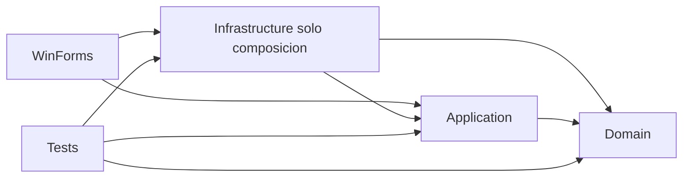
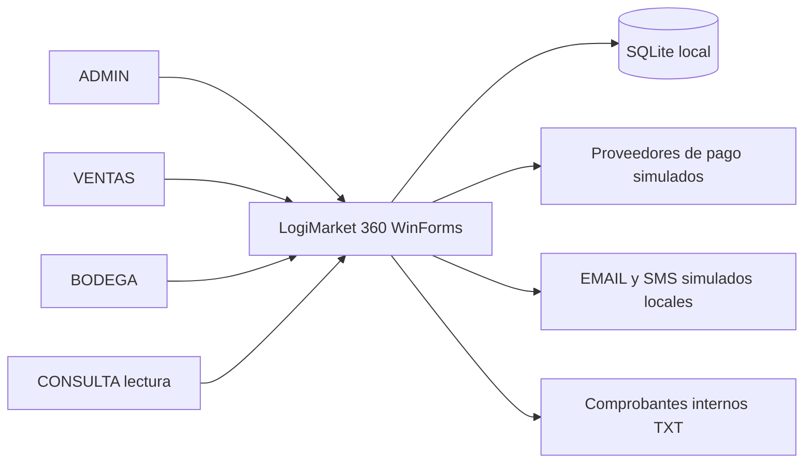
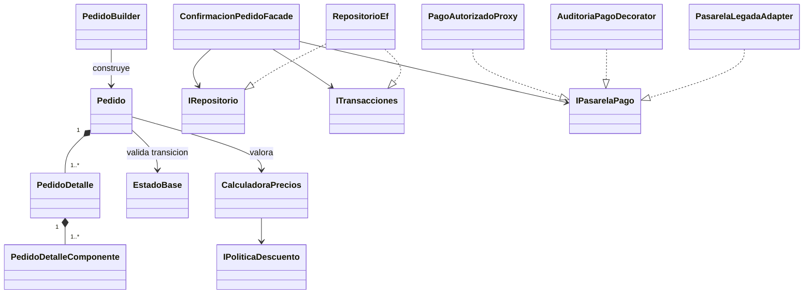
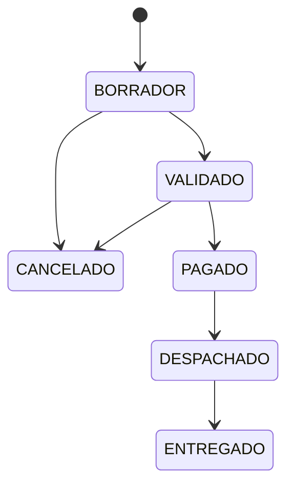
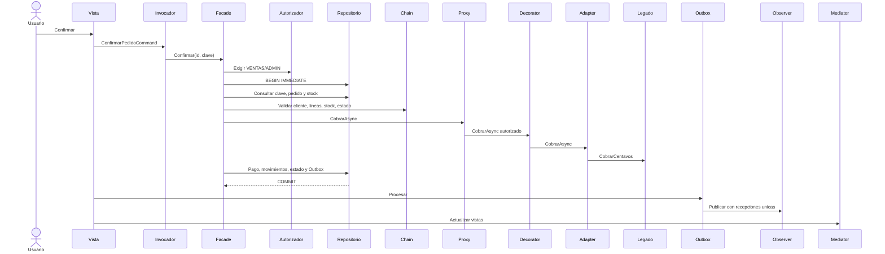
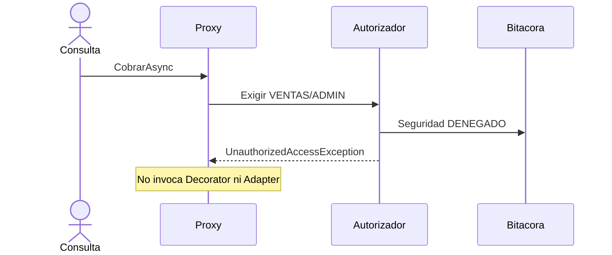
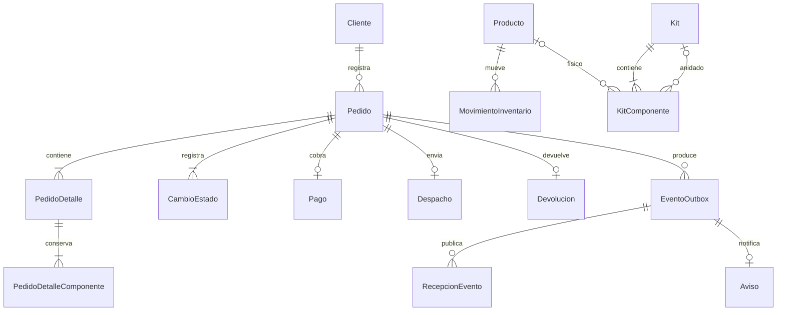

# Arquitectura y decisiones

## Dependencias

Domain no referencia EF, SQLite ni interfaz. Application utiliza puertos; Infrastructure implementa los puertos. La interfaz registra concretos en Program y utiliza servicios de aplicacion. Cada operacion visual crea un ambito DI nuevo: no se conserva un DbContext entre formularios.

## Estados

## Contexto del sistema

## Clases criticas

## Ciclo de estados

## Confirmacion aceptada

## Operacion rechazada

## Modelo relacional

Usuario y Auditoria complementan el modelo. Usuario conserva rol y hash. Auditoria conserva usuario, fecha, operacion, resultado y correlacion. Los componentes de una venta conservan SKU, precio, peso y cantidad historicos; ComposicionJson conserva el arbol anidado. Las relaciones de catalogo utilizan FK reales y las ventas conservan instantaneas independientes.

## Consistencia

SQLite usa BEGIN IMMEDIATE antes de leer stock. La base serializa escritores incluso entre procesos. Producto y Pedido ademas tienen tokens de version. Existen indices unicos para pedido pagado, clave, referencia, devolucion y movimientos por referencia/producto/motivo. Los cobros simulados tienen idempotencia en sesion y la persistencia es la fuente de verdad despues del commit. No se pretende simular una transaccion bancaria distribuida.

Las notificaciones son locales y se guardan con su recepcion en la misma transaccion del procesador. El procesador serializa publicaciones; registra recepciones por evento/suscriptor y permite recuperar eventos pendientes. MetricasSesion es memoria de sesion, no un reporte historico de ventas.

ADMIN administra catalogo y demostracion. VENTAS administra clientes, pedidos, cobros y devoluciones. BODEGA registra movimientos, despacho y entrega. CONSULTA solo lee. Los permisos de devolucion y ajustes son decisiones documentadas para completar los aspectos no detallados de la matriz de roles de la guia.

## SOLID

SRP: CalculadoraPrecios calcula y RepositorioEf persiste. OCP: politicas adicionales implementan IPoliticaDescuento. LSP: ambos proveedores cumplen los mismos tests contractuales. ISP: IPasarelaPago e ISalidaDocumento tienen una sola responsabilidad; las consultas operativas se separan de transacciones. DIP: Facade depende de IRepositorio, ITransacciones e IPasarelaPago.

Compromisos: las consultas utilizan entidades de dominio desconectadas y colecciones de lectura para mantener un alcance academico manejable; para grandes volumenes se recomendaria paginacion y proyecciones DTO. No se agregan microservicios, web ni pagos externos.
